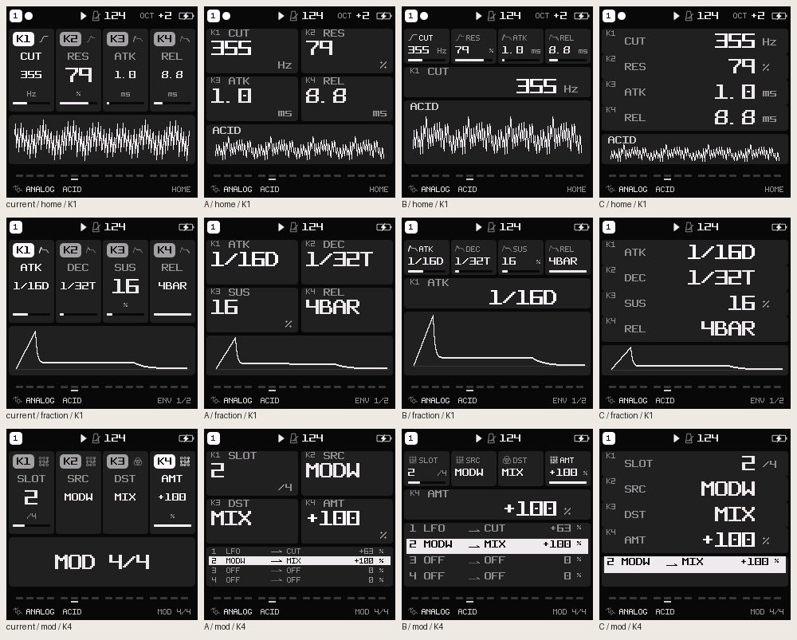

<!-- SPDX-License-Identifier: GPL-3.0-only -->
# LARGE readability directions — throwaway prototype #572

Three native layout directions for [#572](https://github.com/kmplngj/Felucca/issues/572),
based on the readable-state/SEL patch in [draft PR #574](https://github.com/kmplngj/Felucca/pull/574).
**No layout has been selected or adopted into firmware.**



## Question and recommendation

Can a player read values still only 9 px high in LARGE, without losing the four
knobs' relationship or the musical context needed to edit them?

**Continue direction B, Focus + Context, first on a bounded set of value pages.**
It keeps the existing four-column controller strip and adds an 18 px readout
with 9 px units. MOD keeps all four relationships instead of a page title. A/C
show the price of making all four values large at once: smaller diagrams and a
weaker physical mapping. B's simplified FM6/DETAIL/MIXER contexts are not ready
for adoption: feedback/routes, historical lanes and meters still need work.

The owner must choose a direction before a broad LARGE migration. Recommended
first implementation scope after that choice: HOME/ENV/LFO value readout and MOD
context. Keep FM6/operator, STEP DETAIL, MIXER, lists, naming and menus separately
bounded until their context contracts are resolved; do not replace them globally
with this prototype renderer.

## Compare interactively

From this throwaway branch with the build prerequisites and exact Engines pin:

```sh
git submodule update --init
uv run --locked --group build python tests/prototypes/large_readability.py
python3 -m http.server 8768 --bind 127.0.0.1 --directory build/large-prototype
```

Open <http://127.0.0.1:8768/?variant=B&scene=home&theme=GREY&style=FLAT&focus=1>.
The generator needs a host C compiler and the locked image/font dependencies,
but no target toolchain, SDK, Emscripten or FM-1. It only generates assets and
host captures; it cannot flash or change device data.

Use A/B/C or the floating arrows, the scene/theme/style/focus selectors and the
NORMAL/current-LARGE reference. Keyboard arrows work outside input controls.
The URL preserves the visible selection. Native 1× is 240 CSS pixels; 2× uses
nearest integer pixels for inspection, not a physical LCD size simulation.

The gallery shows **captured states**, not a functioning instrument. Switching
focus selects another real fixture/render. No host or device state is persisted.

## Directions and task/role matrix

| Reading task | Current LARGE | A: two columns | B: focus + context | C: four rows |
| --- | --- | --- | --- | --- |
| HOME short/long numeric value | CUT/ATK/REL often M (9 px); RES L | Four wider L values, 18 px | One full-width L value, 18 px; all four normal cards remain | Four right-aligned L values |
| Fractions, signs, units | Long fractions stay M; units S (7 px) | `1/16D`, `1/32T`, `4BAR` fit L; separate M units | Large focused fraction/value and M unit | Large value with M unit beside it |
| MOD connection and ±100% | Large cards plus page title, no relationship list | Four smaller S relationship rows | Four M relationship rows plus large focus | Selected relationship only; other slots hidden |
| FM6 algorithm/operator | Topology replaced by title on these tall-card pages | Algorithm/operator summary only | Six operators and carrier routes derived from actual algorithm data; small S numerals | Algorithm/operator summary only |
| STEP DETAIL | Normal-sized values and four historical lanes | Large values; history replaced by a step strip | Large focused value; step strip replaces the four lanes | Large values; only step context remains |
| Muted track and MIXER | MUTE explicit; compact names remain S | Four small names/MUTE; meters omitted | Four M names and explicit MUTE; meters/PAN context incomplete | Four small names/MUTE; meters omitted |
| Full sound name in USER | Complete selected 12-char name already fits the M list | Unchanged control | Unchanged control | Unchanged control |
| NAME, mixed case and cursor | M letters in separate cells | Common adjunct: exact 2× M pixels, 18 px, contiguous 12-char name + underline; existing key map/footer retained | Same adjunct | Same adjunct |
| DISPLAY setting | Eight dense M rows; LARGE does not grow the selected value | Common adjunct: five rows, selected name/value 2× M; native tabs and value controls retained | Same adjunct | Same adjunct |

Intentional surviving small text:

- Controller-strip labels/values in B provide the four-knob overview. The focus
  readout provides the larger complete value and unit without changing pages.
- Compact graph operator numerals, step marks and nonselected track metadata
  remain S/M to preserve relationships. A/C's summary is an information loss,
  not an equivalent diagram. FM6 feedback and complex routing are not qualified.
- USER names remain M because all twelve characters are already visible. A
  larger selected-name/metadata role is a separate choice; this control avoids
  manufacturing an improvement where the incumbent already fits the task.
- NAME's key map and SAVE/CANCEL remain at their established sizes. The full
  string and cursor become larger, preserving mixed case and the 12-char limit.
- Nonselected menu rows remain M; the selected row supplies the enlarged full
  meaning. Five visible rows imply a scroll window for the remaining rows.

## Interaction policy to decide before implementation

- Keep button families, four parameter mappings, PRESETS/ALGORITHM/SELECT and
  stored IDs unchanged. The browser switcher is outside the instrument and is
  not a proposed firmware navigation mode.
- For B, use the existing last-turned column for focus. Proposed release policy:
  retain that readout in place and let the existing active-color feedback expire;
  do not animate the diagram or move layout when the knob is released.
- The captured states cover K1–K4 and selected boundary cases, not the complete
  idle/turn/release transition or every parameter domain. Those require focused
  behavior tests and range-wide face selection after the owner chooses a layout.
- Keep a single face across each complete value domain. The prototype's width
  decision is sufficient for these captures, not proof for the 1452-domain sweep.
- Resolve font omissions such as Z and long enumerations before promoting any
  role: use the existing complete M glyph data at integer scale where appropriate,
  not a new family or a silently shortened value.
- Menu scrolling must keep selection visible, preserve wrap/tab/row/value
  semantics and cover all eight rows plus AUTO OFF's detail page. This prototype
  only shows the first five rows; it does not implement scrolling.

## Evidence and provenance

- Base UI revision: `7998565964c8f551d47e217b8de31aa9c0c75dbd`.
  Engines: `9630426f5c4a34a209ca851356fbe8ba3c4c6d19`.
- Standard generated profile and M8Stealth. Host Apple Clang 21.0.0, `-O1`,
  actual `tests/ui_render.c` / `ui_test.c` stubs and firmware drawing functions.
- Ten scenes × ten built-in palettes × FLAT/LINE × NORMAL/current LARGE/A/B/C
  × four focus states = **4000 captures**, 240×240 RGB565-to-RGB888 pixels.
- Native lint: **0 findings**. Existing alignment hooks: **0 failures**;
  prototype placements are mostly explicit coordinates, so this is not an
  assertion that every new placement has a declared alignment oracle. No lint
  tolerance was relaxed. Native images were reviewed at 1× as well as on boards.
- Gallery controls, URL state, keyboard arrows and loaded 240 px image dimensions
  were checked in the browser. The one static Impeccable scan flagged inferred
  cross-theme/default-color combinations that do not match the rendered CSS
  variables; actual light/dark text, secondary, control and link pairs exceed
  4.5:1. Added initial image sources and removed the switcher's border/shadow
  duplication from that scan. No second detector run or firmware acceptance is
  implied by these gallery checks.
- Strings are taken from the real NORMAL draw-path output, not a second parameter
  formatter. Existing ADSR geometry is redrawn with the reduced graph height.
  Compact MOD/FM6/track/step contexts are host-only layout sketches using actual
  fixture data; they do not replace the proven firmware graph implementation.
- NAME/menu 2× M output uses a host-only scratch buffer to reproduce the exact
  existing glyph pixels. No extra font, framebuffer/cache, stable ID or firmware
  state has been introduced. Its eventual target rendering/resource cost is
  unmeasured and must be validated before adoption; the host buffer is not a
  proposed target allocation.
- [Source/font/asset hashes](provenance.json). Regenerated outputs and full
  metadata stay under ignored `build/large-prototype/`; the committed PNGs here
  are intentional review artifacts on this throwaway branch.
- [GREY](GREY.png), [PAPER](PAPER.png), [MONO](MONO.png),
  [HI-CON](HI-CON.png), [GREEN](GREEN.png): all ten tasks, NORMAL/current/A/B/C.
- Existing fonts/icons retain their repository notices. M8Stealth by Trash80,
  with embedded ancestry credits: CC BY-SA 3.0; see
  [font provenance](../../../assets/fonts/m8stealth/README.md) and
  [license](../../../LICENSES/CC-BY-SA-3.0-M8Stealth.txt). No donor code/assets copied.

## Remaining qualification and documentation assessment

These images do not establish physical FM-1 readability, normal viewing distance,
ambient light/angle, discovery, redraw latency, target stack/RAM/code size,
audio deadlines, USB/TRS behavior or saved-state compatibility. There is no
flashable LARGE candidate. After direction selection, implement a small page
batch with exact-package, CPU2 variant and combined hardware acceptance as needed.

README and changelog remain unchanged: these are alternatives on a throwaway
branch, not adopted capabilities or a merged behavior change. #571's independent
polish remains in draft PR #574; #572 stays open for the owner's layout decision.
